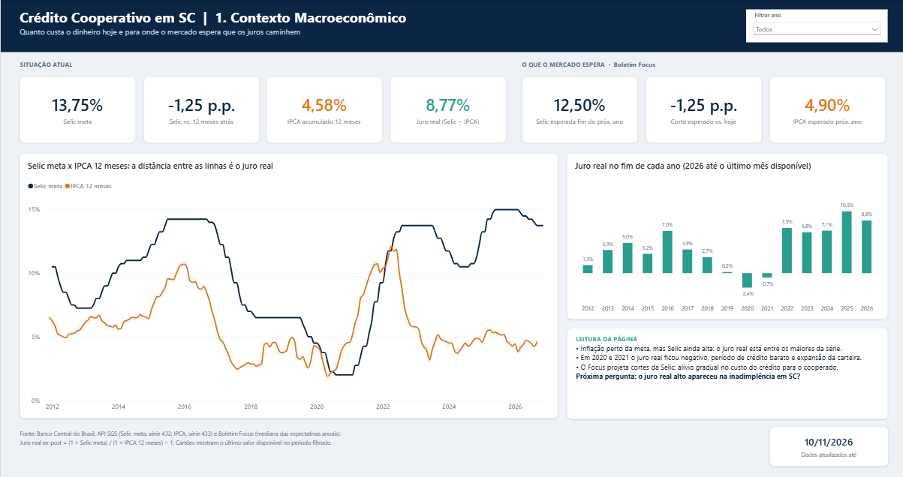
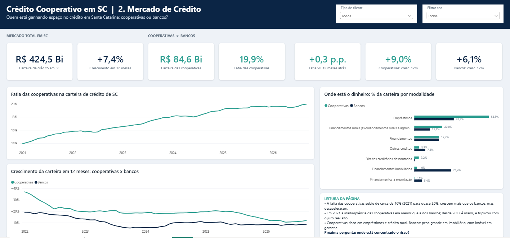

# Crédito Cooperativo em Santa Catarina | Painel em Power BI

Painel de análise do mercado de crédito em Santa Catarina, comparando **cooperativas de crédito** e **bancos**, construído só com **dados oficiais e públicos do Banco Central do Brasil**, que se atualizam a partir da fonte.

> **Pergunta central:** as cooperativas estão ganhando espaço no crédito em SC? E esse crescimento vem com o risco sob controle?





---

## Principais achados (dados até set/2026)

| | Cooperativas | Bancos |
|---|---|---|
| Carteira de crédito em SC | R$ 84,6 bi (**19,9%** do mercado) | R$ 279,1 bi |
| Crescimento em 12 meses | **+9,0%** | +6,1% |
| Inadimplência (atraso > 90 dias) | **4,57%** | 3,64% |

1. **Juro real alto.** Com a Selic em 13,75% e o IPCA 12 meses em 4,58%, o juro real fica perto de 8,8% ao ano, um dos maiores da série. O Boletim Focus projeta cortes até o fim de 2027.
2. **As cooperativas ganham mercado.** A fatia delas no crédito de SC passou de cerca de 16% (fim de 2021) para quase 20%. Crescem mais que os bancos todos os anos, mas o ritmo desacelerou, de cerca de 20% para 9% ao ano.
3. **O risco virou.** No fim de 2021, a inadimplência das cooperativas (1,48%) era **menor** que a dos bancos (1,59%). Desde 2023 ela é **maior**, e triplicou até set/2026, no mesmo período de juro real alto.
4. **O mix explica parte da diferença.** Mais da metade da carteira das cooperativas é empréstimo, e 20% é crédito rural. Os bancos têm cerca de 26% em financiamento imobiliário, modalidade com imóvel em garantia e inadimplência historicamente baixa.

> Coincidir no tempo não é o mesmo que causar: o painel mostra que a inadimplência subiu no período de juro alto, mas não isola o efeito dos juros.

---

## Fontes de dados

| Dado | Fonte oficial | Acesso | Frequência |
|---|---|---|---|
| Selic meta | Banco Central, SGS série 432 | API REST | Diária |
| IPCA (IBGE) | Banco Central, SGS série 433 | API REST | Mensal |
| Expectativas de Selic e IPCA | Banco Central, Boletim Focus (Olinda) | API OData | Semanal |
| Crédito por segmento, modalidade, cliente e porte | Banco Central, **SCR.data** versão 2 | Arquivos ZIP oficiais (sem API) | Mensal |

O SCR.data não tem API: o Banco Central publica um ZIP por ano com um CSV por mês (cerca de 100 MB cada, Brasil inteiro). Como o Power Query não lê ZIP de forma nativa, criei a função **`fnDescompactarZip`**, que lê o formato ZIP byte a byte. Com ela, o Power BI baixa o arquivo oficial, filtra Santa Catarina e agrega os dados durante a atualização, **sem nenhuma etapa manual**.

---

## Modelo de dados

Modelo em estrela, com uma tabela calendário ligada a todas as tabelas fato:

```
             dCalendario (tabela de datas)
            /      |       |        \
       fSelic   fIPCA   fFocus   fCreditoSC
```

- **dCalendario:** tabela de datas em DAX (2011 até hoje), marcada como tabela de datas
- **fSelic / fIPCA / fFocus:** séries macroeconômicas via API
- **fCreditoSC:** cerca de 6 anos de SCR.data filtrado em SC (2021 em diante, ajustável pelo parâmetro `AnoInicialSCR`)
- **_Medidas:** 34 medidas DAX organizadas em pastas, cada uma com descrição

### Destaques de DAX

- **IPCA acumulado em 12 meses** com `PRODUCTX`, porque a inflação se acumula de forma composta: somar as taxas mensais daria um resultado errado.
- **Saldos de carteira como estoque:** a medida pega o valor do último mês do período, em vez de somar meses.
- **Juro real ex-post:** `(1 + Selic) / (1 + IPCA 12m) − 1`.
- **Inteligência de tempo:** crescimento em 12 meses e variação de participação com `DATEADD`, com tratamento para meses ainda sem dado.
- **Participação de mercado e mix:** `REMOVEFILTERS` para calcular o peso de cada segmento e modalidade.

---

## Como abrir

1. Instale o [Power BI Desktop](https://www.microsoft.com/power-platform/products/power-bi/desktop) (gratuito).
2. Clone ou baixe este repositório e abra **`Painel Credito Cooperativo SC.pbip`**.
3. Clique em **Atualizar**. Na primeira vez, autorize as fontes `api.bcb.gov.br`, `olinda.bcb.gov.br` e `www.bcb.gov.br` como **Anônimo**.
4. A carga do SCR.data (2021 em diante, cerca de 900 MB de download) leva alguns minutos.

O projeto está no formato **PBIP** (Power BI Project): modelo e relatório ficam em arquivos de texto (TMDL e JSON), o que permite versionar com Git e revisar cada medida e cada visual.

---

## Próximas etapas (organizadas em sprints)

- [x] **Sprint 1:** contexto macroeconômico (Selic, IPCA, juro real, Focus)
- [x] **Sprint 2:** mercado de crédito em SC (carteira, crescimento, participação, mix)
- [ ] **Sprint 3:** risco. A inadimplência maior das cooperativas vem do mix de produtos ou do risco dentro de cada modalidade? (por modalidade, PF/PJ e porte, mais o atraso de 15 a 90 dias como indicador antecedente)
- [ ] **Sprint 4:** benchmark entre cooperativas de SC (IF.data, API OData do Banco Central)

---

## Ferramentas

Power BI Desktop · Power Query (M) · DAX · formato PBIP/TMDL · Git

Desenvolvido com apoio de IA generativa (Claude conectado ao Power BI pelo [Power BI Modeling MCP](https://github.com/microsoft/powerbi-modeling-mcp)) para acelerar a modelagem. A definição das perguntas, a validação dos números e a interpretação dos resultados foram feitas por mim.

---

**Autor:** Maycon Douglas Martendal · Analista de PCP com foco em dados e indicadores · Santa Catarina
